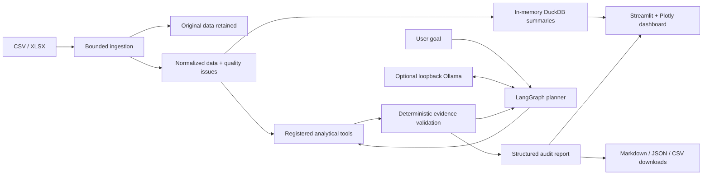

# ExpenseGuard AI

**An evidence-first expense auditing application with controlled LangGraph tool use and optional local AI.**

ExpenseGuard turns CSV/XLSX expense exports into explainable review flags, budget reconciliation,
interactive charts and downloadable audit evidence. Deterministic financial checks work without
an LLM, GPU, paid API or external database.

Independent portfolio project. Fictional sample data only. Flags are investigation leads, not fraud
verdicts, accounting assurance or instructions to deny payment.

## Business problem and solution

Expense exports can contain repeated invoices, invalid fields, unusual amounts and expenses above
allocated budgets. ExpenseGuard preserves the upload, builds an explicitly normalized analytical
copy, and runs independent, testable checks. Every finding contains source-row references,
transaction identifiers, a rule, evidence, severity and a suggested investigation action.

## Implemented features

- CSV/XLSX ingestion: 10 MB and 100,000-row limits, bounded XLSX expansion, readable errors.
- Separate original preview, normalized representation and row-level quality findings.
- Exact invoice duplicate groups and possible duplicates within a configurable date window.
- Monthly department/cost-center budgets without summing repeated allocations.
- Category-level IQR upper-tail screening with cohort-size safeguards.
- Missing/invalid field checks, duplicate transaction IDs and EUR-only validation.
- DuckDB department/category/month summaries, financial KPIs, Plotly charts.
- LangGraph planning, registered-tool execution, validation, inspection and finish state.
- Optional local Ollama selection and structured investigation recommendations.
- Explicit deterministic fallback when a model is unavailable or repeatedly invalid.
- Markdown, JSON evidence and spreadsheet-safe findings CSV downloads.
- Seeded 1,200-row dataset with an injected-condition manifest.
- Tests and CI; no paid API or live Ollama needed for tests.

Reports are Markdown/JSON/CSV; this application does not implement PDF export or persistent case
management. Data and audit state last only for the current Streamlit session.

## Architecture



### Technology

Python 3.11+, Streamlit, pandas, DuckDB, Pydantic, LangGraph, requests/Ollama, Plotly, openpyxl,
pytest/pytest-cov, Ruff and GitHub Actions. Exact dependency versions are in `requirements.txt`.
The application uses no microservices or container orchestration.

## Run locally on macOS

Install Python 3.11 or 3.12, then:

```bash
git clone https://github.com/mirza019/expenseguard-ai.git
cd expenseguard-ai
# Before the implementation PR is merged, check out its head branch:
git switch docs/project-documentation
python3 -m venv .venv
source .venv/bin/activate
python -m pip install --upgrade pip
python -m pip install -r requirements.txt
cp .env.example .env
python -m streamlit run app/main.py
```

Open the local URL printed by Streamlit. Click **Load fictional sample dataset**, open Overview,
then run **Run complete deterministic audit**. The application remains usable without Ollama.
A MacBook Air M3 with 16 GB RAM is the intended local machine; its actual inference performance
must be checked on that hardware. Cloud tests used Linux/Python 3.12, not a Mac.

## Optional Ollama and Qwen3

Install Ollama from its official macOS application at https://ollama.com/download.
Start the Ollama application, or use `ollama serve` when no service is already running.

```bash
ollama pull qwen3:4b
ollama show qwen3:4b
ollama list
```

Use the quantized 4B model distribution and inspect `ollama show` to confirm its quantization.
Set `OLLAMA_MODEL` to another installed model tag if necessary. Model availability and hardware
memory requirements are external to this repository; no live model was pulled during cloud tests.

`.env` configuration:

```dotenv
OLLAMA_URL=http://localhost:11434
OLLAMA_MODEL=qwen3:4b
LANGCHAIN_TRACING_V2=false
LANGSMITH_TRACING=false
```

Only HTTP loopback Ollama endpoints are allowed. No credentials are required. Never expose Ollama
to the public internet. AI mode can make up to three failed model requests with default settings
before fallback; each request has a 60-second network timeout. Results display the final mode,
execution trace, tools actually run, and fallback events.

### What makes it agentic?

The model selects one allowlisted tool, receives verified findings, then chooses the next tool
or finish. Tools execute real Python checks; the model cannot execute code, run SQL, browse files
or invent financial values. Recommendations are schema-constrained action selections attached to
validated finding IDs; readable financial explanations come from trusted templates. This deliberately
limits free-form generation. A focused model audit may run fewer than four tools, which is marked
as partial. Use deterministic complete audit when all checks are required.

Sample goals:

- “Audit these expenses and identify the biggest financial risks.”
- “Check for repeated invoices and missing fields.”
- “Review budget overruns, then inspect unusual amounts.”

## Input contract

Required columns:

```text
transaction_id,invoice_id,invoice_date,vendor,department,cost_center,category,
amount,currency,budget_amount,description,payment_status
```

- `invoice_date`: ISO `YYYY-MM-DD` or a native Excel midnight date cell; analytical month is derived from it.
- `amount`, `budget_amount`: nonnegative decimals with at most two decimal places;
  no thousands separators/currency symbols; maximum one billion EUR per field.
- `currency`: EUR only after whitespace trimming and uppercasing.
- `payment_status`: `paid`, `pending`, or `overdue`.
- Missing critical identity, scope, currency, date or amount fields exclude a row from financial
  calculations; the original remains available. See validation evidence for exact exclusions.
- Missing invoice IDs, descriptions, statuses or budgets remain review findings without automatically
  removing valid expense amounts. Conflicting budgets prevent a complete variance result.
- Duplicate transaction IDs remain flagged and retained. Row numbers disambiguate repeated IDs.
- Additional columns are preserved in the original preview but not used by analytics.

### Budget definition

`budget_amount` is a repeated monthly allocation at **month × department × cost_center** grain,
not a per-transaction entitlement. One distinct nonmissing allocation per group is counted once.
Multiple distinct allocations are conflicts. A group with no usable allocation is unknown.

Variance = actual − budget; positive means overspend.
Variance % = 100 × (actual − budget) / budget; undefined for zero/unknown budgets.
Overall variance is withheld if any represented allocation is unknown/conflicting. Known subtotals
remain in the structured report. Budgets for months/groups absent from the file are not inferred.
Partial uploads therefore do not represent an organization’s complete budget.

### Analytical rules

- **Exact duplicates:** nonblank invoice ID + case-insensitive vendor + exact cents + date.
- **Possible duplicates:** same vendor/cents within 3 days by default. Each record is linked to
  its nearest preceding candidate; this is bounded evidence, not every possible pair. Exact
  same-group pairs are suppressed. Invoice text is case-normalized for matching.
- **Outliers:** category Q3 + 1.5 × IQR, using at least 8 eligible observations. Only upper-tail
  expenses are flagged. Small categories are explicitly reported as skipped; zero IQR uses Q3.
- **Quality:** required columns, missing fields, dates, monetary parsing, currency, status and IDs.

Costs use integer cents for reconciliation. Actuals include all payment statuses and retain
potential duplicates. Human review is required before changing records.

## Synthetic data

```bash
python scripts/generate_data.py --rows 1200 --seed 42
```

`data/synthetic_expenses.manifest.json` identifies deliberate exact/possible duplicates, missing
vendor, invalid date/amount, unsupported currency, duplicate ID and a large expense that creates
a budget overrun. Seeded random data also creates incidental outliers and review candidates.
Data generation is not a claim of real-world detection performance. `sample_expenses.csv` is the
legacy scaffold fixture and does not satisfy the new full upload schema; use `synthetic_expenses.csv`.

## Testing and CI

```bash
python -m ruff check .
python -m ruff format --check .
python -m pytest --cov --cov-report=term-missing --cov-report=xml
```

CI runs on main/feature/docs pushes and PRs targeting main, with Python 3.11/3.12. It installs
pinned dependencies, checks Ruff and formatting, runs tests, enforces 80% core coverage, and uploads
coverage XML. Tests mock Ollama and include a complete Streamlit audit interaction.
See [testing](docs/testing.md) for scope and measured results.

## Git workflow

Feature milestones are stacked in the requested order; main remains unchanged until human review.
The final documentation branch contains the complete integrated implementation. Review the final
integration PR for the runnable product. Do not merge partial historical milestones independently
without checking their dependency chain. No force-push or automatic merge is used.

For future changes:

```bash
git switch main
git pull --ff-only
git switch -c feature/your-change
# implement, test, commit, push, then open a PR targeting main
```

## Security and reliability

- Session-local data; no external expense storage or paid APIs.
- Local model receives bounded finding evidence, which may include vendor information. Do not upload
  confidential data without authorization. Keep external tracing disabled.
- No unrestricted agent SQL, Python execution or filesystem access.
- Explicit schemas, reference validation, finite-number checks and financial reconciliation.
- Bounded upload size/row count/workbook expansion and bounded model response/call counts.
- Downloaded finding CSV neutralizes leading spreadsheet-formula characters.
- Original records are retained; automatic deduplication and silent financial corrections are avoided.
- No authentication or production multiuser controls. Run locally for the MVP.

## Limitations and future improvements

This is a production-style portfolio implementation, not a certified audit platform. It supports
one currency and nonnegative expenses only. Statistical thresholds can miss issues or flag legitimate
spending. Department budgets may be incomplete in partial uploads. AI can select a limited audit
scope; model recommendations require human review. Local Ollama/Qwen inference and Mac performance
are not cloud-verified. No durable audit history, PDF output, SSO, ERP integration or automated
payment decisions are implemented.

Future work: separate budget-file ingestion, refunds/FX policy, case management, calibrated review
thresholds, authenticated deployment and measured local model evaluations. For deployment later,
first define authentication, authorized data handling, persistence and a secure model-hosting plan.
A cloud Streamlit host cannot reach Ollama running on a visitor’s Mac through its own localhost.

## Documentation

- [Architecture and handover](docs/architecture.md)
- [Agent workflow](docs/agent-workflow.md)
- [Testing and verification](docs/testing.md)

MIT licensed. No fabricated screenshots or financial claims are included.
