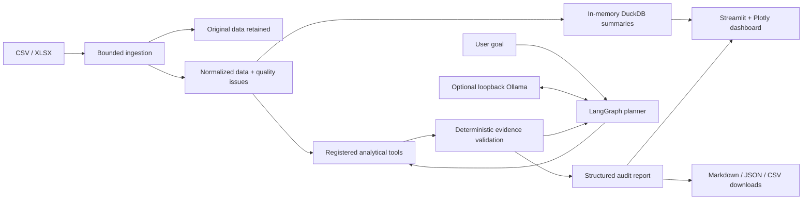

# ExpenseGuard AI

**An evidence-first expense auditing application with controlled LangGraph tool use and optional local AI.**

ExpenseGuard turns CSV/XLSX expense exports into explainable review flags, budget reconciliation,
interactive charts and downloadable audit evidence. Deterministic financial checks work without
an LLM, GPU, paid API or external database.

Independent portfolio project. Fictional sample data only. Flags are investigation leads, not fraud
verdicts, accounting assurance or instructions to deny payment.

## Business problem and solution

Expense exports can contain repeated invoices, invalid fields, unusual amounts and expenses above
allocated budgets. ExpenseGuard preserves the upload, builds an explicitly normalized analytical
copy, and runs independent, testable checks. Every finding contains source-row references,
transaction identifiers, a rule, evidence, severity and a suggested investigation action.

## Implemented features

- CSV/XLSX ingestion: 10 MB and 100,000-row limits, bounded XLSX expansion, readable errors.
- Separate original preview, normalized representation and row-level quality findings.
- Exact invoice duplicate groups and possible duplicates within a configurable date window.
- Monthly department/cost-center budgets without summing repeated allocations.
- Category-level IQR upper-tail screening with cohort-size safeguards.
- Missing/invalid field checks, duplicate transaction IDs and EUR-only validation.
- DuckDB department/category/month summaries, financial KPIs, Plotly charts.
- LangGraph planning, registered-tool execution, validation, inspection and finish state.
- Optional local Ollama selection and structured investigation recommendations.
- Explicit deterministic fallback when a model is unavailable or repeatedly invalid.
- Markdown, JSON evidence and spreadsheet-safe findings CSV downloads.
- Seeded 1,200-row dataset with an injected-condition manifest.
- Tests and CI; no paid API or live Ollama needed for tests.

Reports are Markdown/JSON/CSV; this application does not implement PDF export or persistent case
management. Data and audit state last only for the current Streamlit session.

## Architecture



### Technology

Python 3.11+, Streamlit, pandas, DuckDB, Pydantic, LangGraph, LangChain ChatOllama, the Ollama Python SDK, Plotly, openpyxl,
pytest/pytest-cov, Ruff and GitHub Actions. Exact dependency versions are in `requirements.txt`.
The application uses no microservices or container orchestration. Node 22 is needed only for static frontend tests, not local app startup.

## Quick Start — one command after cloning

Supported: macOS Apple Silicon and Linux with **Python 3.11 or 3.12** already installed.

```bash
git clone https://github.com/mirza019/expenseguard-ai.git
cd expenseguard-ai
./start.sh
```

Until PR #1 is merged, run `git switch docs/project-documentation` after cloning to use the
complete implementation. Main deliberately remains unchanged pending review.

`start.sh` locates its own project root, creates `.venv`, installs exactly pinned dependencies,
creates `.env` from the example without replacing existing values, creates local directories,
generates the fictional sample if missing, checks configuration, and launches Streamlit bound to
`127.0.0.1:8501`. No manual activation is required. It never installs privileged system software
or downloads model weights. Use `bash start.sh` if execute permissions were lost.

Subsequent starts compare dependency fingerprints and installed package versions/imports. They skip
pip when the environment is intact, and reinstall if requirements changed or a dependency is missing.
Interrupted setup never writes a success stamp. Concurrent setup is blocked by a local lock.
Use `EXPENSEGUARD_PYTHON=/path/to/python3.12 ./start.sh` to select an interpreter, or
`./start.sh --server.port 8502` for another port. Do not expose the unauthenticated app publicly.

Windows has an optional equivalent: `powershell -File start.ps1` or `pwsh -File start.ps1`.
PowerShell startup is provided but not verified in this Linux environment; macOS/Linux are primary.
Python/venv installs and first-time dependencies require internet. Once dependencies and a model
are present, repeated local startup and auditing can work offline. Model weights remain in Ollama’s
normal storage, never in the repository.

## First-run AI setup

The full dashboard and deterministic audits work **without Ollama or a GPU**.
The sidebar checks the local service at startup (cached for 15 seconds) and shows:

- **AI Ready:** the configured exact model tag is listed and model metadata is accessible.
  Agent Mode becomes available automatically; no download happens.
- **Model Download Required:** Ollama is reachable but the configured model is absent.
  Click **Download & Enable AI** to pull weights, view per-layer progress, verify installation,
  and enable Agent Mode.
- **Ollama Unavailable:** setup instructions and deterministic auditing remain available.

Install the Ollama macOS application separately from https://ollama.com/download and launch it.
On Linux follow the official installation instructions and start the service. If installed but not
running, use `ollama serve` in another terminal. The application never silently installs Ollama.

Default model: **`qwen3:4b-q4_K_M`**. This quantized 4B model is intended for the MacBook Air M3
with 16 GB RAM; live memory/latency must still be measured on that hardware. The download is several
GB: reserve **at least 6 GB of free disk** as practical headroom; exact weight size is model/version
dependent. Initial download needs internet. Successful retries reuse Ollama’s existing layers.
A failed/interrupted download leaves Agent Mode disabled until installation is verified.

You can alternatively install explicitly with the Ollama CLI:

```bash
ollama pull qwen3:4b-q4_K_M
ollama show qwen3:4b-q4_K_M
```

`.env` is created automatically and ignored by Git:

```dotenv
OLLAMA_URL=http://localhost:11434
OLLAMA_MODEL=qwen3:4b-q4_K_M
LANGCHAIN_TRACING_V2=false
LANGSMITH_TRACING=false
```

Only HTTP loopback Ollama endpoints are allowed. `ChatOllama` is initialized lazily on an explicit
agent request, verifies the model, and requests Pydantic-structured decisions. There are no inference
calls or downloads at import time. SDK availability checks use a short timeout; inference has its
own bounded timeout. API readiness confirms installation/reachability, not guaranteed GPU/CPU memory
or generation quality; inference errors still use bounded retries and deterministic fallback.

### Troubleshooting

- **Python not found:** install Python 3.11/3.12, or set `EXPENSEGUARD_PYTHON` to its executable.
- **Incomplete/wrong-version `.venv`:** stop the app, rename `.venv`, then rerun `./start.sh`.
- **Linux cannot create venv:** install your distribution’s matching `python3-venv` package.
- **Dependency install fails:** check internet/package-index access and rerun. No success stamp is
  stored on failure. Changed or missing dependencies are automatically rechecked next time.
- **Setup lock remains after a crash:** confirm no setup process is running, then remove
  `.venv/.expenseguard-setup.lock` and retry. Never remove a live process’s lock.
- **Ollama unavailable:** launch the app/service, confirm `ollama list` works, check `.env`, and
  click **Refresh AI status**. A reachable loopback service works even if the CLI is not on PATH.
- **Download fails:** check free disk, connectivity, and `ollama show`/the configured model tag.
  Retry the button; the UI verifies installation after pulling rather than trusting a final message.
- **Model already present under another tag:** either install the exact configured tag or update
  `OLLAMA_MODEL`; tags are not silently treated as interchangeable.
- **Slow/failed inference:** close memory-heavy apps, confirm the quantized model is installed,
  shorten the audit goal, or continue with deterministic mode. No GPU is assumed.
- **Port occupied:** stop the previous app or use `./start.sh --server.port 8502`.
- **Offline first run:** dependencies and optional model weights must already be installed/cached;
  there is no bundled model or claim that a fresh offline clone can install itself.

### What makes it agentic?

The model selects one allowlisted tool, receives verified findings, then chooses the next tool
or finish. Tools execute real Python checks; the model cannot execute code, run SQL, browse files
or invent financial values. Recommendations are schema-constrained action selections attached to
validated finding IDs; readable financial explanations come from trusted templates. This deliberately
limits free-form generation. A focused model audit may run fewer than four tools, which is marked
as partial. Use deterministic complete audit when all checks are required.

Sample goals:

- “Audit these expenses and identify the biggest financial risks.”
- “Check for repeated invoices and missing fields.”
- “Review budget overruns, then inspect unusual amounts.”

## Input contract

Required columns:

```text
transaction_id,invoice_id,invoice_date,vendor,department,cost_center,category,
amount,currency,budget_amount,description,payment_status
```

- `invoice_date`: ISO `YYYY-MM-DD` or a native Excel midnight date cell; analytical month is derived from it.
- `amount`, `budget_amount`: nonnegative decimals with at most two decimal places;
  no thousands separators/currency symbols; maximum one billion EUR per field.
- `currency`: EUR only after whitespace trimming and uppercasing.
- `payment_status`: `paid`, `pending`, or `overdue`.
- Missing critical identity, scope, currency, date or amount fields exclude a row from financial
  calculations; the original remains available. See validation evidence for exact exclusions.
- Missing invoice IDs, descriptions, statuses or budgets remain review findings without automatically
  removing valid expense amounts. Conflicting budgets prevent a complete variance result.
- Duplicate transaction IDs remain flagged and retained. Row numbers disambiguate repeated IDs.
- Additional columns are preserved in the original preview but not used by analytics.

### Budget definition

`budget_amount` is a repeated monthly allocation at **month × department × cost_center** grain,
not a per-transaction entitlement. One distinct nonmissing allocation per group is counted once.
Multiple distinct allocations are conflicts. A group with no usable allocation is unknown.

Variance = actual − budget; positive means overspend.
Variance % = 100 × (actual − budget) / budget; undefined for zero/unknown budgets.
Overall variance is withheld if any represented allocation is unknown/conflicting. Known subtotals
remain in the structured report. Budgets for months/groups absent from the file are not inferred.
Partial uploads therefore do not represent an organization’s complete budget.

### Analytical rules

- **Exact duplicates:** nonblank invoice ID + case-insensitive vendor + exact cents + date.
- **Possible duplicates:** same vendor/cents within 3 days by default. Each record is linked to
  its nearest preceding candidate; this is bounded evidence, not every possible pair. Exact
  same-group pairs are suppressed. Invoice text is case-normalized for matching.
- **Outliers:** category Q3 + 1.5 × IQR, using at least 8 eligible observations. Only upper-tail
  expenses are flagged. Small categories are explicitly reported as skipped; zero IQR uses Q3.
- **Quality:** required columns, missing fields, dates, monetary parsing, currency, status and IDs.

Costs use integer cents for reconciliation. Actuals include all payment statuses and retain
potential duplicates. Human review is required before changing records.

## Synthetic data

```bash
python scripts/generate_data.py --rows 1200 --seed 42
```

`data/synthetic_expenses.manifest.json` identifies deliberate exact/possible duplicates, missing
vendor, invalid date/amount, unsupported currency, duplicate ID and a large expense that creates
a budget overrun. Seeded random data also creates incidental outliers and review candidates.
Data generation is not a claim of real-world detection performance. `sample_expenses.csv` is the
legacy scaffold fixture and does not satisfy the new full upload schema; use `synthetic_expenses.csv`.

## GitHub-hosted companion frontend

`site/` contains a burgundy, responsive **static report viewer** for GitHub Pages. It can load a
fictional demo or a locally exported JSON report, filter findings, inspect evidence, show spending
and download the selected report. User-opened reports remain in the browser; there is no upload
endpoint and no direct browser-to-Ollama access.

GitHub Pages cannot execute Python, Streamlit, LangGraph or local Ollama. Full uploads and audits run
through `./start.sh`. This separation avoids a separate cloud backend and keeps private expenses local.

The Pages workflow is **manual only**. After reviewing/merging the implementation:

1. Repository Settings → Pages → Source: GitHub Actions.
2. Actions → **Publish GitHub Pages companion (manual)** → Run workflow.
3. Use the deployment URL returned by GitHub (normally `https://mirza019.github.io/expenseguard-ai/`).

No site is automatically deployed by pushes or PRs. Repository permissions may require an owner to
enable Pages. Build the fictional demo locally with `python scripts/build_pages_demo.py`; generated
`site/demo-report.json` is ignored by Git and built in the workflow. No private report is published.

## Testing and CI

```bash
bash -n start.sh
python scripts/check_environment.py
python -m ruff check .
python -m ruff format --check .
python -m pytest --cov --cov-report=term-missing --cov-report=xml
node --test tests/frontend/report.test.mjs
```

CI runs on main/feature/docs pushes and PRs targeting main, with Python 3.11/3.12. It installs
pinned dependencies, checks Ruff and formatting, runs tests, enforces 80% core coverage, and uploads
coverage XML. Tests mock Ollama and include a complete Streamlit audit interaction.
See [testing](docs/testing.md) for scope and measured results.

## Git workflow

Feature milestones are stacked in the requested order; main remains unchanged until human review.
The final documentation branch contains the complete integrated implementation. Review the final
integration PR for the runnable product. Do not merge partial historical milestones independently
without checking their dependency chain. No force-push or automatic merge is used.

For future changes:

```bash
git switch main
git pull --ff-only
git switch -c feature/your-change
# implement, test, commit, push, then open a PR targeting main
```

## Security and reliability

- Session-local data; no external expense storage or paid APIs.
- Local model receives bounded finding evidence, which may include vendor information. Do not upload
  confidential data without authorization. Keep external tracing disabled.
- No unrestricted agent SQL, Python execution or filesystem access.
- Explicit schemas, reference validation, finite-number checks and financial reconciliation.
- Bounded upload size/row count/workbook expansion and bounded model response/call counts.
- Downloaded finding CSV neutralizes leading spreadsheet-formula characters.
- Original records are retained; automatic deduplication and silent financial corrections are avoided.
- No authentication or production multiuser controls. The launcher binds to loopback; run locally for the MVP.

## Limitations and future improvements

This is a production-style portfolio implementation, not a certified audit platform. It supports
one currency and nonnegative expenses only. Statistical thresholds can miss issues or flag legitimate
spending. Department budgets may be incomplete in partial uploads. AI can select a limited audit
scope; model recommendations require human review. Local Ollama/Qwen inference and Mac performance
are not cloud-verified. No durable audit history, PDF output, SSO, ERP integration or automated
payment decisions are implemented.

Future work: separate budget-file ingestion, refunds/FX policy, case management, calibrated review
thresholds, authenticated deployment and measured local model evaluations. For deployment later,
first define authentication, authorized data handling, persistence and a secure model-hosting plan.
A cloud Streamlit host cannot reach Ollama running on a visitor’s Mac through its own localhost. The GitHub Pages companion does not attempt to do so.

## Documentation

- [Architecture and handover](docs/architecture.md)
- [Agent workflow](docs/agent-workflow.md)
- [Testing and verification](docs/testing.md)

MIT licensed. No fabricated screenshots or financial claims are included.
