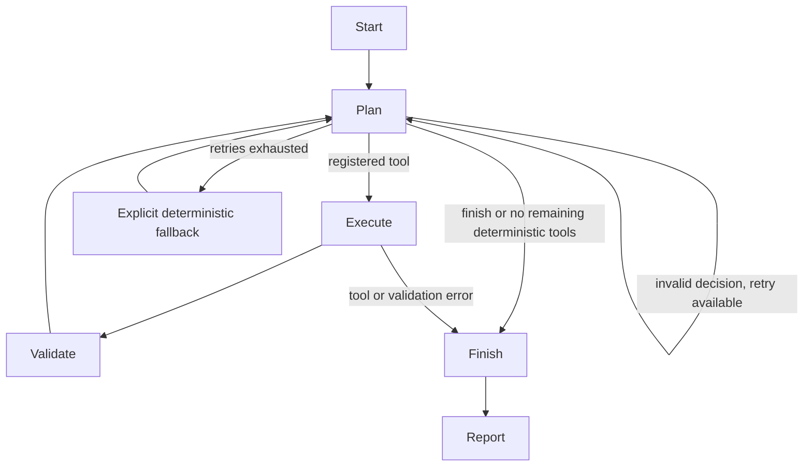

# LangGraph workflow

## State

`AuditState` records validated data, user goal, current mode, results keyed by tool name, pending tool,
call count, retry count, safe error messages, execution trace, recommendations, completion and report.
Every run creates a new state. No global agent memory or cross-user checkpoint is configured.

## Decisions and execution

Agent mode sends a bounded summary of up to 40 findings to LangChain ChatOllama using a loopback Ollama endpoint. The model
returns a Pydantic/JSON-schema `Decision`: a registered tool or finish, plus optional finding-linked
recommendations from four approved investigation actions. The planner receives executed tools and
remaining tools after each step. User text is treated as data; no code/SQL/filesystem tool is registered.

Selection is dynamic: a focused request may finish early. The report lists actual scope and the UI
marks fewer than four executed tools as partial. Deterministic mode runs all four checks, without
claiming autonomous AI.

Tools are registered as LangChain StructuredTool instances, bound to the current validated upload. Only the fixed current_upload scope is accepted; no user-controlled SQL or data access is exposed. Tool results are produced by Python. Validation checks tool status/identity, finite values, evidence,
aligned source-row/transaction references, independently summed actuals and budget reconciliations.
Invalid IDs, repeated tools, unknown actions, malformed JSON and unavailable endpoints are rejected.
Model prose is not trusted to introduce financial figures. Explanations use verified rule templates;
the model explains priorities through referenced, constrained investigation actions.

## Bounds and failure behavior

Default agent limit: four tool calls, no repeats. Default retries: two after the first failed model
request; retry count is cumulative. One final model inspection can occur after the fourth tool, but
cannot execute a fifth. Failed model requests eventually change mode to deterministic and complete
remaining checks, never re-running successful tools. Deterministic completion can exceed a smaller
custom *agent* call limit, but the registry still limits total distinct tool executions to four.

Model request: 60-second network timeout, 600 output-token preference, 32 KB context cap, fixed
loopback endpoint, schema validation. LangGraph recursion is bounded at 40. Model error text is not
shown because endpoint responses could contain financial data. Failed tool execution stops the run
with explicit errors and any successfully validated partial results. The UI warns about partial scope.

No live model is required for deterministic operation. Tests use controlled planners and mocked HTTP
responses. Pulling and running Qwen3 and checking its tool decisions on a Mac are separate manual
acceptance steps; the cloud environment has not verified actual model quality.

## Runtime setup

The SDK model manager checks the CLI separately from loopback service availability. It lists exact
model tags and verifies metadata before enabling the UI. Downloads happen only through the explicit
button; streaming progress is shown, generators are closed, exceptions are converted to safe setup
errors, and the model is checked again after completion. No model download occurs on import,
startup, in tests, or CI. ChatOllama initialization is lazy and validates installed model availability
on an explicit audit request. The default is qwen3:4b-q4_K_M.

## Optional PDF action

`generate_report` is an allowlisted terminal action available only after all four financial tools
complete. LangGraph builds the financial snapshot, then invokes deterministic report validation and
PDF rendering. The model supplies neither PDF code nor financial values. Explicit non-LLM callers
can use `run_audit(data, generate_pdf=True)`. Failed validation returns `pdf_error` without bytes.
The existing ordinary audit path remains unchanged and does not render on every run.

## Policy and period context extension

The entry point parses supported month/year, department and DE/FR scope and retains original source-row
IDs. The scoped `ValidatedData` is returned with the audit; dashboard and PDF read that same object.
An optional registered `policy_retrieval` tool performs supported deterministic controls against the
loaded policy index. Its evidence is verified against original PDF hashes, applicability and sections.
State carries the index, source root, policy results and failure status. Four financial calls, one
policy step and the optional report action remain bounded. Policy failure does not invalidate verified
financial calculations, but is explicit and prevents an unsupported policy PDF conclusion.

The model context includes verified SQL totals, structured scope and bounded policy evidence. Modular
prompts in `app/prompts/` cover interpretation, selection, retrieval, explanations, classification,
evidence validation, summary and escalation. No model can execute arbitrary SQL/Python or modify
records. The deterministic policy engine is the calculation authority. Tests in
`test_policy_intelligence.py` exercise the integrated graph, source failures and mocked model paths;
live Qwen tool selection remains unverified in this environment.
