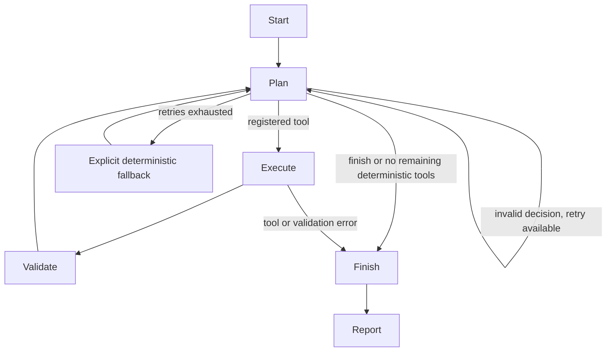

# LangGraph workflow

## State

`AuditState` records validated data, user goal, current mode, results keyed by tool name, pending tool,
call count, retry count, safe error messages, execution trace, recommendations, completion and report.
Every run creates a new state. No global agent memory or cross-user checkpoint is configured.

## Decisions and execution

Agent mode sends a bounded summary of up to 40 findings to a loopback Ollama chat endpoint. The model
returns a Pydantic/JSON-schema `Decision`: a registered tool or finish, plus optional finding-linked
recommendations from four approved investigation actions. The planner receives executed tools and
remaining tools after each step. User text is treated as data; no code/SQL/filesystem tool is registered.

Selection is dynamic: a focused request may finish early. The report lists actual scope and the UI
marks fewer than four executed tools as partial. Deterministic mode runs all four checks, without
claiming autonomous AI.

Tool results are produced by Python. Validation checks tool status/identity, finite values, evidence,
aligned source-row/transaction references, independently summed actuals and budget reconciliations.
Invalid IDs, repeated tools, unknown actions, malformed JSON and unavailable endpoints are rejected.
Model prose is not trusted to introduce financial figures. Explanations use verified rule templates;
the model explains priorities through referenced, constrained investigation actions.

## Bounds and failure behavior

Default agent limit: four tool calls, no repeats. Default retries: two after the first failed model
request; retry count is cumulative. One final model inspection can occur after the fourth tool, but
cannot execute a fifth. Failed model requests eventually change mode to deterministic and complete
remaining checks, never re-running successful tools. Deterministic completion can exceed a smaller
custom *agent* call limit, but the registry still limits total distinct tool executions to four.

Model request: 60-second network timeout, 600 output-token preference, 256 KB response cap, fixed
loopback endpoint, schema validation. LangGraph recursion is bounded at 40. Model error text is not
shown because endpoint responses could contain financial data. Failed tool execution stops the run
with explicit errors and any successfully validated partial results. The UI warns about partial scope.

No live model is required for deterministic operation. Tests use controlled planners and mocked HTTP
responses. Pulling and running Qwen3 and checking its tool decisions on a Mac are separate manual
acceptance steps; the cloud environment has not verified actual model quality.
