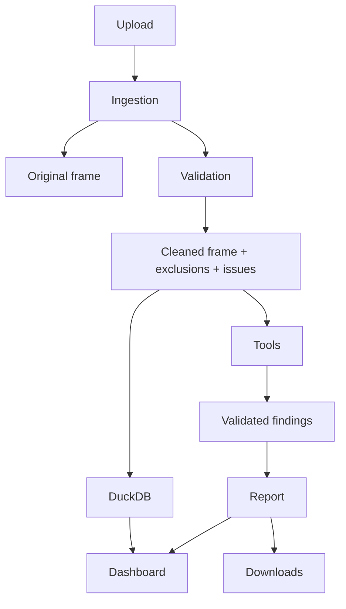

# Architecture and operational handover

## Components

`app/main.py` composes upload, dashboard, audit, agent and reporting panels. Services perform ingestion,
validation, tool registration and reporting. Tools return Pydantic results. The database adapter opens
and closes one in-memory DuckDB connection per fixed aggregate query; it never accepts arbitrary SQL.
LangGraph carries per-run state without shared checkpoints. Settings use `.env` for local Ollama. The model manager uses the Ollama Python SDK, and inference uses LangChain ChatOllama.

## Data ownership and transformations

The user owns uploaded data. No original uploaded financial data is written to disk. The launcher creates ignored environment/config/cache directories and uses the intentional fictional fixture. The normalized copy trims strings,
uppercases currency, parses exact cents and dates, derives months, and marks financial eligibility.
`source_row` refers to CSV/worksheet row numbers with row 1 reserved for headers. Duplicate IDs are
not removed; row numbers are the stable evidence references. XLSX ingestion reads the first sheet.
Files with repeated headers or nonstandard schemas should be corrected before loading.

Budget allocation grain is month/department/cost center. Repeated equal values represent one budget,
not multiple allocations. Conflicts are surfaced and aggregate variance is withheld. Financial
actuals include all payment statuses and duplicate candidates until review. Totals describe the
uploaded file, not necessarily an entire organization.

## State lifecycle

A successful load replaces the session dataset and clears previous audit outputs. Failed loads retain
the preceding dataset with an explicit warning. Reruns retain session state; browser-session loss or
process restart removes it. Report exports use memory, not shared temporary paths. No cross-user
persistent connection or cache stores financial records.

## Suggested ownership and runbook

For this solo project, the developer maintains source and tests; an expense reviewer investigates
flags; a budget owner resolves allocation conflicts. These are proposed responsibilities, not claims
of actual organizational deployment.

1. Install pinned dependencies in a virtual environment.
2. Run lint, tests and coverage before changes.
3. Regenerate fictional fixtures only with a recorded seed and review the manifest.
4. Start Streamlit and load a small sample before real authorized uploads.
5. Verify exclusions, currency and budget scope before interpreting totals.
6. Check actual mode/tools/errors in every report.
7. Download evidence before closing the session.
8. To recover from model failure, run a complete deterministic audit.

Handover acceptance: validate CSV/XLSX, demonstrate invalid-upload feedback, reconcile financial totals,
execute each tool, run a complete audit, test the optional model locally, inspect exports and trace,
and record the tested machine/model version. No model training or scheduled retraining is involved.

## Deployment later

The full audit application is local. A static companion report viewer is prepared for manual GitHub Pages hosting. Before public deployment add authentication/authorization, data retention policies,
secure persistent storage and access controls. Localhost Ollama means the app server’s machine, not
the visitor’s machine. Never expose an unauthenticated model endpoint or financial upload interface.
CI validates code but does not deploy or merge.

## One-command bootstrap

`start.sh` resolves the root, selects Python 3.11/3.12, creates/reuses .venv, locks setup, checks exact
distribution versions and imports, installs only when needed, preserves existing .env, generates a
missing demo, validates configuration and execs Streamlit on loopback. A failed install cannot write
a success stamp. Local model weights are managed solely by Ollama. `start.ps1` provides a Windows
equivalent but remains unverified without PowerShell on the test machine.

GitHub Pages serves only the report viewer. Its manual workflow builds a fixed fictional report; it
never publishes private uploads, serves Python or connects a public browser to a private model.
