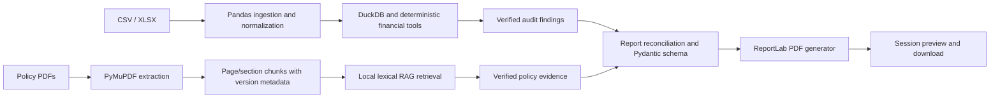

# Professional PDF audit reports

## Architecture and validation boundary



Transaction files are never converted into intermediate PDFs. Input policies and output reports have
different responsibilities. Policy retrieval is a small, model-free addition because the previous
repository had no policy RAG subsystem. No embedding/Qwen model is downloaded for reporting or tests.

`report_validation.prepare_report` independently reruns the four registered deterministic checks,
compares their outputs and summary with the audit snapshot, validates recommendations against approved
actions/finding IDs, queries financial series through DuckDB, verifies policy evidence, and returns
`AuditPDFReport`. ReportLab receives that typed structure rather than raw LLM output. Integer cents,
finite values, source counts, variance formulas, finding IDs and chart/table totals are reconciled.
All financial charts render the same series as their tables. Unknown budgets are never drawn as zero.

## User workflow

1. Run `./start.sh`; upload a valid CSV/XLSX or load the fictional sample.
2. Run all four checks using complete deterministic audit, or an agent audit that executes all four.
3. Open **Audit report → Generate Audit Report**.
4. Select start/end dates. For a narrower period, click **Prepare selected-period audit** and review
   its displayed findings. Those findings, not full-upload findings, are used for its PDF.
5. Optionally register a text-based policy PDF with title, version and effective date.
6. Optionally include existing, verified AI-selected investigation actions.
7. Click **Generate PDF Audit Report**, then **Preview generated PDF** or **Download PDF Audit Report**.

Preview uses the same retained bytes as download. Browsers can block embedded PDF viewing; download
is always the fallback. Reports larger than 8 MB skip the embedded preview. The filename uses
`ExpenseGuard_Audit_Report_YYYY-MM-DD.pdf`.

Session artifacts are keyed by source/cleaned data, tool results, audit summary, period, AI option,
and policy bytes/metadata. Changed inputs invalidate them. Ordinary Streamlit reruns do not regenerate
the PDF. Uploading new data resets period controls and report caches. Reports/policies are not stored
permanently or shared across sessions.

## Report contents

A4 pages include cover/source/period/mode; executive KPIs and status; budget versus actual, department,
category and monthly charts with tables; ranked unfavorable cost centers; all verified financial
findings; policy evidence; a labeled investigation summary; methods and limitations. Headers, footers,
page numbers, repeating table headings and splitting cells/paragraphs support long reports.

Finding amounts are affected recorded expenses, not proven losses. Overlapping findings cannot be
summed as a loss estimate. Statistical outliers and duplicate candidates are not confirmed fraud.
Unknown/conflicting budgets remain unevaluable; zero-budget percentage variance is undefined.

Full-range reports retain undated records as quality issues. Narrower periods exclude undated rows
because their period cannot be established. Original source-row references remain stable. Every report
requires at least one dated source record. Totals cover the uploaded file, not an entire organization.

## Policies and citations

Policies must be textual, unencrypted PDFs, at most 10 MB, 100 pages and 500,000 extracted characters.
The UI accepts at most five session documents. Scanned/image-only PDFs need external OCR first.

Extraction keeps same-page, same-section passages (1,400-character windows, 150-character overlap),
SHA-256 document/chunk IDs and the uploader-declared title, version and effective date. Retrieval
uses keyword overlap; it is not semantic search. The latest effective version per title is selected
for each transaction date. Ambiguous versions with the same title/effective date fail closed.

Every printed citation is checked against retained PDF bytes, re-extracted chunks, quoted text,
page/section, metadata, transaction row/ID and effective-version selection. Titles/versions are declared
by the uploader, not authenticated against a corporate document registry.

Only this intentionally narrow full-line grammar supports automatic exception screening:

```text
Travel expenses must not exceed EUR 500.00 per transaction.
Software expenses must not exceed EUR 500.00 per transaction.
Supplies expenses must not exceed EUR 500.00 per transaction.
```

Category is case-insensitive; the positive/zero limit can vary. The observed amount and exact quoted
limit are validated. An excess is a **potential policy exception**, pending human review of scope,
exceptions and approvals. Supported-rule comparisons and unique exception-row counts are distinct.

Other retrieved passages are **related guidance** only, never automatic violations. At most 12 guidance
passages are retained for review. If no supported applicable rule exists, compliance is explicitly
**not evaluated**, even when guidance or future policy documents are present. These checks are not
an exhaustive legal or organizational compliance assessment.

## AI and agent integration

Financial facts, charts, rendering and default investigation explanations are deterministic. The AI
option includes only approved investigation actions linked to verified findings from a previous
agent audit; it does not request new free-form Qwen prose or invent causes. Missing AI or unverified
recommendations cannot become financial facts. Without eligible AI actions, reporting falls back to
a clearly labeled deterministic summary.

LangGraph supports `generate_report` only after all four checks. The report node calls the same
validation/rendering service. `run_audit(data, generate_pdf=True)` explicitly requests deterministic
PDF generation; ordinary audits do not render PDFs. Failures return a report error and no PDF bytes.

## Headless rendering and fonts

ReportLab Platypus composes the document. Matplotlib Agg creates PNG charts in memory, without a
browser, Kaleido or display server. Render locks protect shared font/plot state. Bundled DejaVu fonts
cover Latin/Greek/Cyrillic; a CID font handles CJK. Other unsupported glyphs are displayed as explicit
Unicode code-point labels rather than silently replaced. XML-sensitive text is escaped. The original
source text remains in session/JSON evidence.

Font licenses are included under `app/reports/assets/fonts/`. Application code is MIT; third-party
libraries retain their own licenses, including PyMuPDF's AGPL/commercial licensing terms.

## Verification and examples

Tests cover reconciliation, altered financial results, NaN/infinity, missing fields, incorrect periods,
exact/possible duplicate references, statistical/quality findings, citation fabrication, date/version
selection, deterministic/AI summaries, empty findings, long Unicode descriptions, multi-page tables,
chart generation, agent requests/failures, UI download and cache invalidation. PyMuPDF renders actual
pages and checks text bounding boxes against A4 content/header/footer limits.

```bash
python -m pytest tests/unit/test_pdf_generator.py tests/unit/test_report_validation.py \
  tests/unit/test_policy_rag.py tests/integration/test_report_workflow.py
python scripts/generate_sample_report.py
```

See [the synthetic report](examples/ExpenseGuard_Synthetic_Audit_Report.pdf) and its
[fictional policy](examples/fictional_expense_policy.pdf). Neither contains real financial records.
